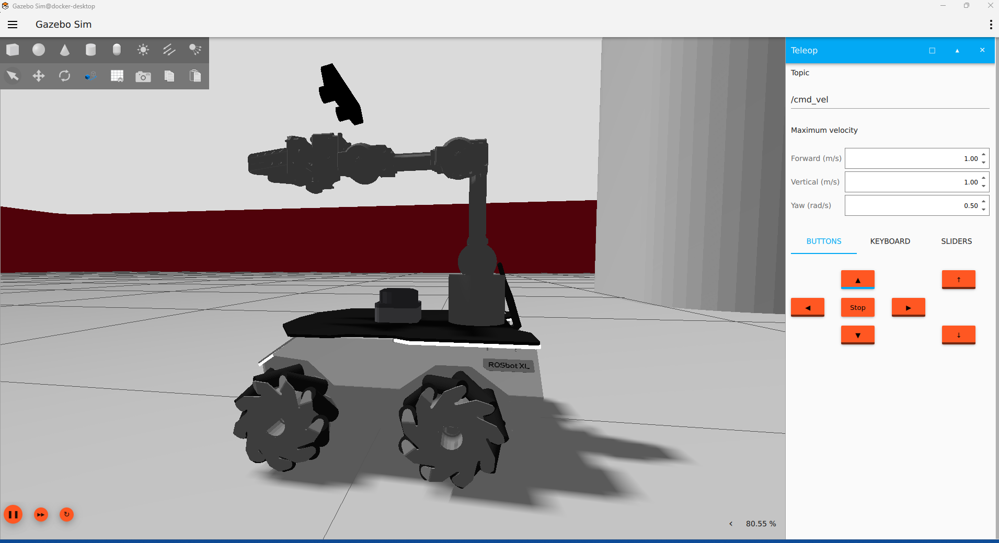
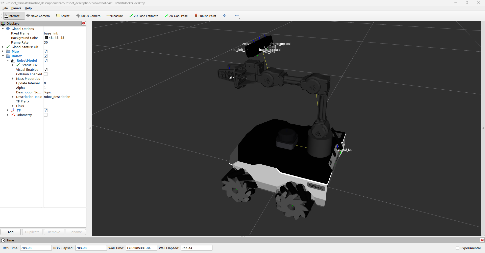

# ROSbot XL setup

This guide defines the reference ROSbot XL development environment:

- Ubuntu 24.04
- ROS 2 Jazzy
- a native workspace at `~/rosbot_ws`
- the official Husarion ROSbot sources
- the custom robot and sensor repositories

The native Ubuntu 24.04 installation is the recommended, reproducible
workflow. Docker on an Ubuntu 22.04 host remains an alternative.

## 1. References

- [Husarion](https://husarion.com/)
- [Husarion tutorials](https://husarion.com/tutorials/)
- [Official `rosbot_ros` Jazzy branch](https://github.com/husarion/rosbot_ros/tree/jazzy)

## 2. Native Ubuntu 24.04 installation

### 2.1. Obtain this repository and run the installer

The installation script is stored in this repository. On a fresh Ubuntu 24.04
computer, first clone the repository into a temporary development location:

```bash
mkdir -p ~/repositories
cd ~/repositories
git clone https://github.com/manelpuig/my_rUBot_rosbot.git
cd my_rUBot_rosbot/Documentation/Files/ROSbot_install
```

Run the installer:

```bash
chmod +x install_rosbot_native.sh
./install_rosbot_native.sh
```

The script:

1. Installs ROS 2 Jazzy and its development tools.
2. Creates `~/rosbot_ws/src`.
3. Clones the official `husarion/rosbot_ros` Jazzy branch.
4. Imports the official hardware and simulation repositories with `vcs`.
5. Installs dependencies with `rosdep`.
6. Builds the workspace with `colcon`.
7. Adds the ROS 2 and workspace setup commands to `~/.bashrc`.

Open a new terminal after the script finishes, or load the environment:

```bash
source /opt/ros/jazzy/setup.bash
source ~/rosbot_ws/install/setup.bash
```

Verify the base environment:

```bash
echo "$ROS_DISTRO"
ros2 pkg prefix rosbot_gazebo
colcon list --base-paths ~/rosbot_ws/src
```

Expected results:

- `ROS_DISTRO` is `jazzy`.
- `rosbot_gazebo` is found in `~/rosbot_ws/install`.
- The official ROSbot packages appear in the package list.

Do not source a Humble workspace in the same terminal. Each ROS distribution
must use its own terminal and its own `build`, `install`, and `log`
directories.

### 2.2. Validate the official simulation

Always validate the official stack before adding the custom repositories:

```bash
source /opt/ros/jazzy/setup.bash
source ~/rosbot_ws/install/setup.bash

ros2 launch rosbot_gazebo simulation.yaml \
  robot_model:=rosbot_xl \
  use_sim:=True \
  configuration:=basic \
  arm_activate:=False \
  rviz:=True
```

The `robot_model` argument is required when `ROBOT_MODEL` is not defined.
Supported configurations include `basic`, `telepresence`, `autonomy`,
`manipulation`, `manipulation_pro`, and `custom`.

For example:

```bash
ros2 launch rosbot_gazebo simulation.yaml \
  robot_model:=rosbot_xl \
  use_sim:=True \
  configuration:=manipulation_pro \
  arm_activate:=True \
  rviz:=True
```

While the simulation is running, verify it from a second terminal:

```bash
source /opt/ros/jazzy/setup.bash
source ~/rosbot_ws/install/setup.bash

ros2 node list
ros2 topic list | sort
ros2 topic echo /odometry/wheels --once
```

The basic simulation should provide `/cmd_vel`, `/odometry/wheels`,
`/imu/data`, `/tf`, and `/tf_static`, among other topics.





### 2.3. Add the custom robot and sensor repositories

Use one workspace for the complete ROSbot XL Jazzy system:

```text
~/rosbot_ws/
|-- src/
|   |-- official Husarion repositories
|   |-- my_rUBot_rosbot/
|   |-- ENS160_air_quality/
|   `-- my_rUBot_sensors/
|-- build/
|-- install/
`-- log/
```

Clone the custom repositories:

```bash
cd ~/rosbot_ws/src
git clone https://github.com/manelpuig/my_rUBot_rosbot.git
git clone https://github.com/manelpuig/ENS160_air_quality.git
git clone https://github.com/manelpuig/my_rUBot_sensors.git
```

Install their dependencies and build the complete workspace:

```bash
cd ~/rosbot_ws
source /opt/ros/jazzy/setup.bash

rosdep install --from-paths src --ignore-src -r -y
colcon build --symlink-install
source install/setup.bash
```

List the expected custom packages:

```bash
colcon list | grep -E \
  'my_rosbot|ens160|rubot_sensor|rubot_ens160'
```

Expected packages:

- `my_rosbot_bringup`
- `my_rosbot_control`
- `ens160_interfaces`
- `ens160_air_quality_ros`
- `rubot_sensor_bringup`
- `rubot_ens160_mapping`

### 2.4. Build and validate incrementally

First validate the generic ENS160 packages:

```bash
cd ~/rosbot_ws
colcon build --symlink-install \
  --packages-select ens160_interfaces ens160_air_quality_ros

source install/setup.bash
ros2 pkg executables ens160_air_quality_ros
ros2 interface list | grep ens160
```

Then validate the custom ROSbot packages:

```bash
colcon build --symlink-install \
  --packages-select my_rosbot_bringup my_rosbot_control

source install/setup.bash
ros2 pkg executables my_rosbot_control
```

The control package should provide:

```text
my_rosbot_control teleop_simple
```

The custom bringup launch files are being updated to use the current official
`rosbot_gazebo/launch/simulation.yaml` interface. Until they are validated,
use the official simulation command from section 2.2 as the reference test.

### 2.5. Development checkpoints

At each stage, record this information before changing source files:

```bash
git status --short --branch
echo "$ROS_DISTRO"
printenv AMENT_PREFIX_PATH
printenv COLCON_PREFIX_PATH
colcon list
```

After a failed build, keep the complete summary and the first relevant error.
Warnings containing an old workspace path usually indicate that another
workspace is sourced from `~/.bashrc`.

Avoid partial ROS package upgrades. Binary packages built on different dates
can produce `undefined symbol` errors. A fresh native installation built from
the official source workspace is the reference environment for this project.

## 3. Docker alternative for an Ubuntu 22.04 host

The University of Barcelona image provides a ROS 2 Jazzy environment for
simulation and laboratory use:

- Image: `manelpuig/ros2-jazzy-ub-rosbot`
- Configuration directory: `my_rUBot_rosbot/docker_jazzy`

Review the Compose configuration before starting it:

- Set `ROS_DOMAIN_ID` to the group number.
- Use `ROS_AUTOMATIC_DISCOVERY_RANGE=SUBNET` for simulation.
- Use `ROS_AUTOMATIC_DISCOVERY_RANGE=OFF` and configure
  `ROS_STATIC_PEERS` for laboratory use.
- Set `CYCLONEDDS_URI=file:///config/cyclonedds_pc.xml` when required.

On a Linux host:

```bash
cd ~/my_rUBot_rosbot/docker_jazzy
xhost +local:root
docker compose up
```

VS Code can then attach to the container. Inside it, use the official
simulation command from section 2.2.

## 4. Physical ROSbot setup

### 4.1. Connection settings

Default connection details:

- User: `husarion`
- Password: `husarion`
- Hostname: `husarion`
- Ethernet address: `192.168.77.2`

Connect through Ethernet:

```bash
ssh husarion@192.168.77.2
```

or, when mDNS is available:

```bash
ssh husarion@husarion.local
```

Configure Wi-Fi using the robot's current network-management procedure. If it
uses Netplan, inspect the existing files before editing:

```bash
ls -l /etc/netplan
```

Do not assume a fixed Netplan filename. Network credentials and assigned IP
addresses must not be committed to this repository.

### 4.2. Initial communication test

The web interface is normally available at:

```text
http://192.168.77.2:8080/ui
```

Use the actual Wi-Fi address when the robot is connected wirelessly.

For a manual ROS 2 velocity test:

```bash
ros2 run teleop_twist_keyboard teleop_twist_keyboard \
  --ros-args -p stamped:=true
```

Before moving the physical robot, raise its wheels or place it in a clear test
area and be ready to stop the command.

## 5. Planned sensor integration

The ROSbot XL and ENS160 integration will use the same `~/rosbot_ws` workspace.
The planned combined simulation interface is:

```bash
ros2 launch rubot_sensor_bringup ens160_robot.launch.py \
  robot:=rosbot \
  mode:=simulation \
  start_sensor:=false
```

The intended physical interface is:

```bash
ros2 launch rubot_sensor_bringup ens160_robot.launch.py \
  robot:=rosbot \
  mode:=hardware \
  start_sensor:=true
```

These commands document the target design. Do not use them until the matching
`my_rUBot_sensors` implementation has been added and validated.
